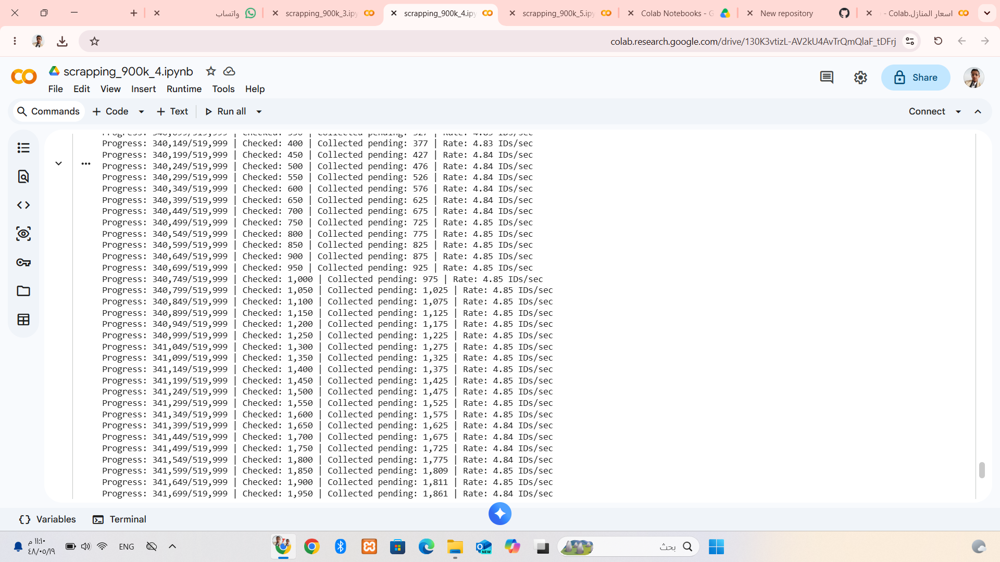
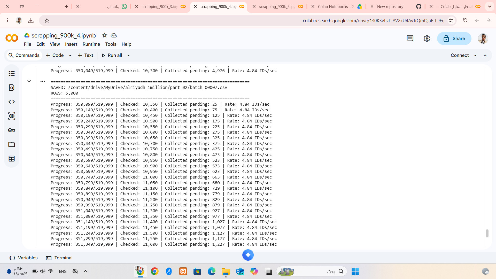
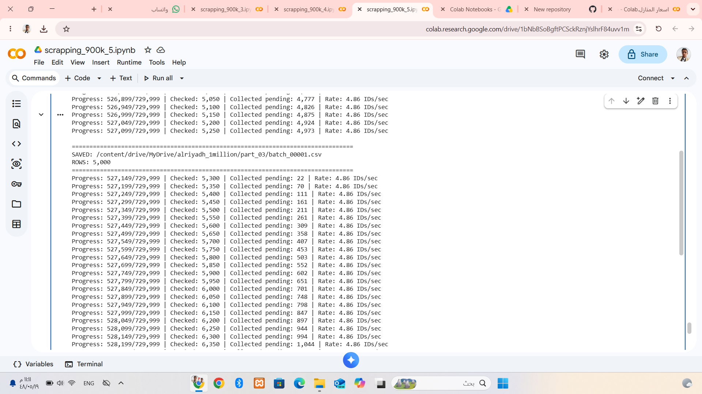

Al Riyadh News — Large-Scale Data Collection

A Distributed Python Pipeline for Collecting Structured Arabic News Data

 

1. Project Overview

Collecting hundreds of thousands of web pages is not simply a matter of sending HTTP requests and parsing HTML.

At this scale, the process introduces engineering challenges involving workload organization, network reliability, execution time, failure handling, and data preservation.

This project addresses these challenges by implementing a Python-based news data collection pipeline targeting Al Riyadh, a Saudi Arabian newspaper.

The collection workflow was divided into five independent Jupyter notebooks, each responsible for a dedicated article identifier range. These notebooks were executed through five separate Google Colab sessions to distribute the overall workload.

The project explores how a large collection task can be organized into manageable, independently executable workloads while maintaining a consistent data extraction structure.

2. The Engineering Problem

A basic web scraping script may work well when collecting a small number of pages. However, scaling the process introduces several difficulties:

- Execution Time: Processing a large number of pages sequentially can take considerable time.
- Network Reliability: Requests may fail because of timeouts, temporary server errors, or connectivity interruptions.
- Workload Management: Large identifier ranges need to be organized and distributed.
- Data Preservation: Long-running sessions may be interrupted before the entire collection is completed.
- Data Consistency: Extracted fields must follow a consistent structure across different collection tasks.
- Operational Monitoring: Progress and collection status need to be observable.

Main Engineering Question

How can a large-scale Arabic news collection process be organized into independent workloads while supporting concurrent requests, failure handling, and incremental data preservation?

3. Why Al Riyadh?

The project uses "Al Riyadh" (https://www.alriyadh.com/) as its data source.

The selection was based on the website's relevance to Arabic news data collection and its editorial structure.

The website provides:

- Arabic-language news articles.
- Multiple editorial categories.
- Article publication dates.
- Historical news and archive content.
- Saudi and regional news coverage.

These characteristics make it a useful case study for building a structured Arabic news metadata collection workflow.

The project focuses on collecting structured metadata rather than reproducing the newspaper's complete editorial content.

4. Architecture and Workload Distribution

Instead of relying on one large collection task, the workload was divided into five independent parts.

Each notebook was assigned a separate article identifier range.

Collection Part| Notebook| Start ID| End ID
01| "scrapping_900k_part_1.ipynb"| 100,000| 309,999
02| "scrapping_900k_part_2.ipynb"| 310,000| 519,999
03| "scrapping_900k_part_3.ipynb"| 520,000| 729,999
04| "scrapping_900k_part_4.ipynb"| 730,000| 939,999
05| "scrapping_900k_part_5.ipynb"| 940,000| 1,149,999

Execution Strategy

The five notebooks were executed using five separate Google Colab sessions.

This approach was selected to:

1. Divide the overall workload into independent ranges.
2. Allow separate execution and monitoring.
3. Reduce dependence on one long-running notebook session.
4. Make individual collection tasks easier to restart.
5. Organize the collection process into manageable units.

Important distinction: The five-session design distributes the overall workload. "ThreadPoolExecutor" is also used in the collection workflow for concurrent request processing. These are two separate levels of execution organization.

Collection Workflow

             Al Riyadh Website
                     |
                     v
             Article ID Ranges
                     |
          +----------+----------+
          |          |          |
          v          v          v
       Part 01    Part 02    Part 03
          |          |          |
       Colab 1    Colab 2    Colab 3

          +----------+----------+
          |                     |
          v                     v
       Part 04                Part 05
          |                     |
       Colab 4                Colab 5
          |                     |
          +----------+----------+
                     |
                     v
             Structured Records
                     |
                     v
              Batch Data Saving
                     |
                     v
              Dataset Preparation

5. Data Schema

The collection workflow extracts the following structured fields:

Field| Description
"url"| Original article URL
"title"| Article title
"category"| Article category
"country"| Associated country information
"date"| Article publication date

The extracted fields provide a structured representation of the collected news metadata.

This structure can support subsequent data cleaning, exploratory data analysis, visualization, and Arabic NLP experiments.

6. Technologies and Tools

Technology| Role
Python| Main implementation language
Requests| HTTP requests and page retrieval
BeautifulSoup| HTML parsing and extraction
lxml| HTML parsing support
Pandas| Structured data processing
ThreadPoolExecutor| Concurrent request processing
Jupyter Notebook| Collection workflow implementation
Google Colab| Cloud-based execution environment

7. Reliability and Collection Mechanisms

The implementation incorporates several mechanisms to make long-running collection tasks more manageable.

Request Handling

Uses HTTP requests to retrieve article pages.

Retry Mechanism

Supports retrying requests after temporary failures.

Concurrent Processing

Uses "ThreadPoolExecutor" to process multiple requests concurrently within the collection workflow.

Progress Tracking

Provides progress visibility during long-running execution.

Batch Saving

Saves collected records in batches instead of relying only on one final output operation.

Emergency Saving

Includes a mechanism intended to preserve collected records if execution is interrupted.

These mechanisms help organize the workflow, but they do not guarantee that every identifier corresponds to an accessible article or that every request succeeds.

8. Dataset and Collection Results

The completed collection run was reported to contain approximately:

Metric| Reported Result
Collected Records| ~900,000
Approximate Storage Size| ~200 MB
Collection Notebooks| 5
Independent Colab Sessions| 5
Sample Dataset| 5,000 Rows

These figures describe the reported collection output. They should not be interpreted as a verified count of unique, valid, or fully cleaned articles.

Sample Dataset

A sample containing 5,000 records is included in:

"data/sample/sample of data.csv"

The sample provides a smaller representation of the collected dataset for inspection and schema understanding.

The full collection output is not included in this repository.

Data rights: The original articles and other website content remain the property of their respective rights holders. The sample should contain only information that may lawfully be redistributed. This project does not claim ownership of the newspaper's content.

9. Repository Structure

AlRiyadh-News-Data-Collection/
│
├── assets/
│   ├── screenshot-01.png
│   ├── screenshot-02.png
│   ├── screenshot-03.png
 
├── data/
│   └── sample/
│       ├── sample of data.csv
│       └── .gitkeep
│
├── notebooks/
│   ├── scrapping_900k_part_1.ipynb
│   ├── scrapping_900k_part_2.ipynb
│   ├── scrapping_900k_part_3.ipynb
│   ├── scrapping_900k_part_4.ipynb
│   ├── scrapping_900k_part_5.ipynb
│   └── .gitkeep
│
├── .gitignore
├── README.md
└── requirements.txt

10. Project Screenshots

The following screenshots showcase selected stages of the data collection workflow and project execution.

<table>
<tr>
<td align="center">

 
<strong>Screenshot 01</strong>
</td>
<td align="center">

 
<strong>Screenshot 02</strong>
</td>
<td align="center">

 
<strong>Screenshot 03</strong>
</td>
</tr>
</table>

Requirements

- Python 3.x
- Jupyter Notebook or Google Colab
- Internet connectivity
- Dependencies listed in "requirements.txt"

Installation

git clone https://github.com/esmailemrany/AlRiyadh-News-Data-Collection.git

cd AlRiyadh-News-Data-Collection

pip install -r requirements.txt

Running the Notebooks

1. Open the "notebooks/" directory.
2. Select one of the five collection notebooks.
3. Review its assigned identifier range.
4. Configure the execution environment and storage paths.
5. Execute the notebook cells in order.

The notebooks were originally designed for Google Colab. Environment-specific paths and Google Drive integration may require adjustment when running locally.

Responsible Collection

Before running the collection workflow, review the target website's terms and access policies. Use reasonable request rates and avoid placing unnecessary load on the website.

12. Limitations and Future Improvements

The current implementation provides a foundation for large-scale Arabic news metadata collection. The following improvements could strengthen it further.

Data Quality

- Duplicate URL detection.
- Missing-value analysis.
- Field validation.
- Date standardization.
- More detailed data quality reports.

Collection Reliability

- Structured logging.
- More detailed failure classification.
- Checkpoint-based recovery.
- Request rate control.
- Automated validation after each collection batch.

Data Engineering

- Separate raw, cleaned, and processed datasets.
- Centralized storage.
- Dataset versioning.
- Automated data validation pipelines.

Analytics and AI

- News category distribution analysis.
- Publication trend analysis.
- Temporal news activity analysis.
- Geographical coverage analysis where supported by the data.
- Arabic NLP applications.

These items are proposed future improvements, not claims about features already implemented.

13. What This Project Demonstrates

This project demonstrates practical experience with:

- Large-scale web data collection.
- Arabic news metadata extraction.
- HTTP request handling.
- HTML parsing.
- Workload distribution.
- Concurrent request processing.
- Batch-based data saving.
- Long-running notebook workflows.
- Structured dataset preparation.

It also establishes a foundation for further exploration in data engineering, data analytics, and Arabic natural language processing.

14. Disclaimer

This is an independent educational and technical project.

It is not affiliated with, sponsored by, or officially associated with Al Riyadh newspaper.

All website content and intellectual property remain the property of their respective rights holders. The project must be used responsibly and in accordance with applicable website policies and laws.

---

Author

Esmail Emrany

AI & Data Science Student

"GitHub Profile" (https://github.com/esmailemrany)

 Building structured data collection workflows for real-world data engineering challenges.

